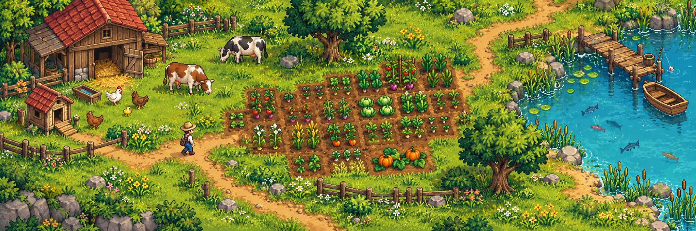

# 桌面农场下一版开发规划：三场景画质与完整牧场生活

日期：2026-10-02；鱼塘结算规则修订与完整开发确认：2026-10-03。基线：0.8.0，Git提交 `4398c1de12a02acadd1224219678b6d1ab8023e4`。目标版本：0.8.1。状态：用户已明确要求“按照文档进行开发”，完整范围开发中；最终实际交付与验收以新版开发规格及验收记录为准。

## 1 本轮交付范围与已确认选择

用户要求：实际画面达到所附概念图的细节与田园观感；农场、牧场、鱼塘为三个独立场景；动物必须离开固定棚位自由运动；规划确认后才开发。

两项选择已确认：

- 默认展开约420逻辑像素高，同时保留240像素紧凑模式和收起工具栏。
- 下一版一并交付三场景画质升级、自由运动/真实觅食、自然牧草、互动加成，以及渔网和鱼塘容量升级。

2026-10-03新增要求及已确认选择：首次捕获未收录鱼时自动消耗该鱼并登记图鉴；已收录图鉴的鱼捕获后直接出售，不再重复登记；两种情况均不弹确认窗口。详见第9节。随后用户明确确认整版按文档开发，无需再次确认已批准的范围。

这份规划整合原方案的B/C工作，取代“0.8.1只做牧场、0.8.2再做鱼塘”的安排。内部按里程碑开发，最终0.8.1的完成条件是全部范围通过验收；美术样张或少数动物能动均不能作为整版已完成。

原有独立96地块、数量购种/种子库、全库耗尽才默认订购、受保护预算、图鉴、50%标准价动物退款和无离线收益继续使用。

## 2 视觉基准与当前差距

参考原图2172×724。用户附件与仓库参考图SHA256相同：`623704b6f278c8ef8ba904d154eba644ffb813168f6ce8d278297cba952323f5`，因此直接复用这份图作为验收依据。

当前场景只有172像素高，运行时作物/动物图标被压缩为32像素格，树和建筑主要由简单色块构成。参考图有丰富草叶、泥土、石块、木材、屋顶纹理，统一的斜俯视角、光照阴影、实体比例和前后遮挡。两者差距不能靠放大现有小图标解决。

下一版制作同风格的地面、边缘、建筑、植物分期、动物/人物动作和水面素材。经营物品图标与场景实体使用不同规格，场景中不再直接复用小库存图标充当成年动物或成熟作物。

美术原则：清晰像素边缘、成簇明暗、丰富春绿与暖土色、木材和瓦片纹理、浅青蓝水面；避免模糊缩放和大块平涂。动植物、人物、树和建筑共用视角、脚底位置和光照方向。

## 3 三个独立场景

| 场景 | 独立构图与主要内容 | 动态表现 |
| --- | --- | --- |
| 农场 | 以连片耕地和自然田埂为主体；农舍/工具棚、土路、树木、石块、野花作边景；不把大型牧场或捕鱼池塞进同一画面 | 作物真实生长阶段、农夫行走/播种/浇水/收割、少量草叶和树叶摆动 |
| 牧场 | 棚舍布置在背景或边缘，开放草场占主要空间；自然草斑、食槽、饮水设施、围栏与可通行出入口 | 所有已购买动物离棚活动、走停转向、寻草/吃草、前往食槽、互动反馈、农夫收取产物 |
| 鱼塘 | 独立自然岸线、清晰水域、木码头、芦苇、岩石、岸边树木和垂钓设施 | 水波、鱼游动/转向、撒网与命中反馈；升级显示对应网具或码头细节 |

参考图用于三个场景的统一美术语言，分别重新构图。不会把合一图截成三个残缺片段，也不会把含固定动物的背景直接用作可玩牧场。背景和可移动实体分层，避免静态牛鸡与真实动画重影。

## 4 展开/紧凑布局与镜头

| 显示方式 | 总逻辑高度 | 场景可用高度 | 用途 |
| --- | ---: | ---: | --- |
| 展开（默认） | 420 | 约352 | 查看细节、选地、动物互动和捕鱼；主要画质验收模式 |
| 紧凑 | 240 | 约172 | 工作时保留较浅的桌面景观，用镜头浏览必要位置 |
| 收起 | 约32 | 隐藏场景 | 保留控制栏，生产继续 |

高度按显示器工作区与DPI夹紧，切换后保存。世界地图和实体大小不随模式变化，紧凑模式裁切镜头而不把整张地图和角色再次压小。保留水平浏览/分页，并增加需要时的纵向平移和目标定位；鼠标在地图内才响应地图平移。

农田建议改为约16列×6行的自然田块布置，仍是96个独立地块，ID与开垦状态保留。宽屏可看见主要构图，窄屏以浏览镜头保持细节，不要求所有地块和84只动物同时挤在一屏。

初始素材尺寸建议：作物48～64像素，人物约48×64，小动物约40～64，大动物约64～96；树和建筑采用更大独立部件。最终在真实420像素窗口确认可读性，再冻结统一比例。高个作物可超出地块土面，命中仍以地块为准。

窗口继续遵循普通应用前后顺序。点击其他应用后该应用优先展示；托盘、隐藏/收起、观察模式穿透、全屏避让继续保留。

## 5 可玩素材与动画

- 地面使用可连接泥土、干湿变化、自然草岸和路缘；树、石、围栏、棚舍使用独立贴图，配合接触阴影。
- 作物至少区分播种/萌芽、幼苗、生长、成熟四种实际造型，浇水和成熟用小提示表达。连续收获作物保留株体，随机种包按实际抽中植物绘制，加工状态不被美术更新重置。
- 人物采用同一新比例，至少覆盖上下左右行走、播种、浇水和收割；动作到达作业点后播放。
- 11类动物全部支持方向和步态，至少四方向、每方向四帧行走，另有停留、进食和互动动作。幼年/成年形态可区分，特殊鸡、恐龙、鸵鸟有各自轮廓，不全部套同一只鸡或牛。
- 鱼有可辨认的三个品种、转向与游动，波纹和撒网反馈使用独立层。
- 动态实体按脚底位置排序；树冠、屋檐、芦苇等前景单独处理遮挡。透明边缘、脚底锚点、图集留边和动作帧一致性需要逐项检查。

素材保留高质量源文件，离线整理成运行图集；不在每帧生成或缩放大图。先用鸡、牛、人物和一组作物建立实际引擎样板，再推广到所有品种，最终交付必须覆盖完整列表。

## 6 动物自由运动与照料

每只动物保存归属棚舍、世界坐标、朝向、行为状态和目标。棚舍承担购买条件、容量和归属功能，正常饲养中的动物可以走出棚舍，在公共牧场活动。

行为流程：出生/迁移到棚舍入口 → 走出棚舍 → 随机短距离闲逛与停留 → 提前寻找食物 → 沿可走路径到达 → 进食 → 继续活动。饥饿动物继续移动和寻粮，但暂停成长/产出；成熟待收动物继续正常活动。

建议沿用原草案速度：小动物12、大动物10逻辑像素/秒，在新的统一世界标尺上调校。速度以模型位置产生真实位移，不以原地抖动或四帧图标替代运动。靠近水、石块、建筑、围栏时绕行；动物不能出地图或进入其他场景。使用软避让，减少重叠和卡在窄入口。

农夫按动物ID认领产物任务，低频更新目标位置；只在近距离照料时让动物短暂停留，到达后完成2秒收取。目标失效、动物出售或超时会取消/重排，不能让动物永久冻结或让农夫无止境追逐。

切场、隐藏和观察模式下动物照常按有效时间活动。退出、休眠不补离线移动或成长。

## 7 自然牧草与真实觅食

牧场取消可见的固定牧草方格。草斑在可生长区域形成不规则轮廓，草丛疏密随真实草量变化，被吃/割处露出稀疏地面，后续继续生长并向邻近空地扩散。

内部草量仍有最多96个逻辑采样点、每点最多4簇，用于容量、账本和性能控制；草丛位置不对齐可见格子，外观和位置保存，重载不会重新随机。扩散候选在可走地面产生，并避开建筑、水域和道路，不能只是定时换一张更茂盛的背景图。

每180有效秒执行生长/扩散，使用快照统一提交，新生草本轮不级联。普通草保留1簇根，2处起始母草作为保护源不可吃/割。扩散仍限制每点候选数量，保留现有概率基准；若邻接从固定四邻改为空间邻近，需对照旧版验证草总量和干草消耗，不能无声翻倍资源产出。草地扩建价格、草种费用和储粮升级沿用原数值。

真实进食规则：

1. 每只动物每300秒需要完整一餐，小动物2簇、大动物4簇，幼崽同样进食。
2. 优先寻找附近可达草斑，预计行走较长时提前出发；到达目标后才进食。
3. 完整一餐先预约再执行。普通满草仅3簇可吃，大动物需要至少两个可达草点。
4. 无完整青草餐则前往食槽，1份干草提供一餐。到不了或无粮则保持饥饿。
5. 草量预约、干草预约与农夫割草共享账本；出售、改道、目标失效、超时均释放未消费资源。
6. 一餐统一结算，不扣半餐；每份草/干草只能消费一次。进食完成后重新计300秒。

初始动物靠近可用食物，避免新局因初次长距离寻路立即全部饥饿。既有已饱食动物保留原剩余餐间隔。

## 8 互动加成与限频

继续采用上一轮已规划的规则，幼年和成年均可获得受限加成：

| 项目 | 数值/行为 |
| --- | --- |
| 每只动物奖励冷却 | 120秒有效游戏时间 |
| 全局奖励间隔 | 2秒；一次点击仅命中最上层的一只动物 |
| 幼年单次奖励 | 成长剩余时间最多减少30秒 |
| 幼年累计上限 | 标准幼年时间20%，同一实例仅一份 |
| 成年单次奖励 | 产出剩余时间最多减少标准周期5% |
| 成年每轮上限 | 标准产出周期10% |
| 饥饿/已有产物待收 | 轻量反馈，不发经济奖励，不消耗新奖励额度 |
| 冷却或额度用尽 | 提示当前状态，不重复加成 |

只减少实际剩余时间，不改变售价、产量，不把幼年溢出奖励转入成年。成年额度在本轮产物收取后重置，奖励冷却不因成年、切场、退出重进或收取重置。冷却、已用额度和周期序号入存档。

例：鸡幼年900秒，最多减180秒；标准产蛋300秒，每次最多减15秒、每轮最多30秒。奖励成功后短暂显示爱心/轻动作，详情在悬停或动物面板，避免每次弹出大窗口。观察模式不会误触奖励。

## 9 鱼塘玩法与升级

鱼塘作为独立场景完成画质与游动，再接入两条升级线。沿用平均鱼价50金币（30/50/70，概率25%/50%/25%）计算，费用均为逐档增量：

| 等级 | 网冷却 | 网升级费 | 鱼容量 | 容量升级费 |
| --- | ---: | ---: | ---: | ---: |
| 初始 | 20秒 | 0 | 12 | 0 |
| 1 | 15秒 | 200 | 18 | 300 |
| 2 | 10秒 | 400 | 24 | 600 |
| 3 | 5秒 | 800 | 36 | 1800 |

网满级累计1400、塘满级累计2700，合计4100。网费=4×平均鱼价×2^(升级序号−1)；容量费=平均鱼价×新增容量×升级序号。全部扣款仍须覆盖实时补种保护。

每180秒补1条，一次网最多1条，空网仍冷却。升级容量不赠鱼、不重置补鱼时间；升级网具只影响下一次出网，当前冷却继续。容量升级表示蓄鱼上限，不暗改繁殖速度或提供自动捕鱼收入。当前仍为三种鱼，售价与出现概率沿用现有配置。

### 9.1 捕获结果自动结算（2026-10-03修订）

| 捕获时的图鉴状态 | 新版处理 | 是否弹窗 |
| --- | --- | --- |
| 已收录该鱼的产物ID | 按实际鱼种售价直接加金币，不再次登记图鉴 | 不弹窗 |
| 尚未收录 | 首次自动登记并消耗这条鱼，不获得金币（用户已确认） | 不弹窗 |

已收录判断使用配置中的 `product_id`（缺省为鱼种ID），而不是中文名或某条鱼的实例ID。自动出售不修改已有图鉴的首次发现时间、登记数量或来源。首次登记保持原本消耗一条鱼的收藏成本，同种鱼从第二条开始直接出售；首条鱼不能同时获得出售金币。三种鱼全部首次收录共消耗三条鱼，对应售价合计150金币；这不是额外扣款，已收录鱼不再次付收藏成本。

反馈使用现有底部短提示，例如“捕获小银鱼，自动出售 +30金币”；首次登记为“首次发现小银鱼，已收录图鉴”。不抢焦点，不打开管理窗口，不要求点关闭或确定。所有捕获结果均不进入等待用户确认的状态，也不会因结果面板未关闭阻止下一次合法出网；渔网冷却照常限制频率。

成功捕获时，移除池中鱼、增加金币或首次登记、清空本次待处理结果和开启渔网冷却由一个经济命令一次提交，并立即原子保存。保存失败必须整体回滚，恢复鱼、金币、图鉴和原冷却；连续点击、重复鱼实例ID和场景切换不能重复出售。

旧存档中的 `pending_fish` 不能丢弃或重新塞回池塘。加载验证后，已收录鱼自动出售并清空待处理状态，一次提交保存；未收录鱼自动消耗并登记。兼容结算保留原有渔网冷却与补鱼剩余时间，不重新出网或补扣次数；保存失败保留旧待处理鱼，重试成功及再次启动后不能重复给钱。

实现时使用显式兼容结算命令，不在 `FarmState.restore()` 中隐式加金币或登记，保证存档失败调用 `restore(before)` 时仍能恢复原状。兼容结算失败后保留清晰的保存重试入口，恢复保存后再结算，不依赖已取消的捕获确认窗口。

## 10 技术拆分、迁移与性能

延续Godot与Win32层，新增场景资产映射、镜头、动物行为/路径、牧草预约、互动额度和鱼塘升级模块。经济命令由统一模型提交并立即原子保存，视图只处理绘制和命中。

移动/行为建议5Hz固定步骤、渲染30/15FPS插值；生产保留稳定计时顺序。寻路在目标变化/失效时计算，食物搜索使用空间索引和低频决策，不每帧做84动物×96草点全扫描。装饰不消耗生产随机流，动物行为使用独立可恢复随机流。

存档拟升级v3，增加动物坐标/行为/目标、草斑位置/预约、互动记录、网/塘等级和显示模式。严格验证v2后复制不可覆盖的版本备份，在内存中迁移并验证再原子落盘；v1先经既有v2迁移。保留金币、地块ID与开垦、实际作物/进度/产物、种子/预留/已付款任务、动物成长与产物、食物、图鉴、随机流和捕鱼冷却。新动物状态从原归属入口初始化，已有饱食时间不重置。

世界布局调整时按稳定目标ID映射农夫与任务：动作中任务保留动作余时；行走中任务保持已领用资源，映射路线进度并重新计算剩余路程。显示模式/分页变化只移动镜头，不能再次重映射世界坐标或改变速度。

按场景加载/释放大素材，保留共享小图集；静态地形/建筑缓存、局部水波/草叶/演员独立动画，隐藏时停绘制。当前峰值工作集约275.60MB，已超过200MB目标；本轮高细节素材还需控制解码峰值、GPU纹理与字体/视窗开销。目标仍为CPU平均≤2%整机容量、峰值工作集≤200MB，最终报告目标与实测，超标必须保留，不能通过回退到旧画质或清空工作集冒充达标。

## 11 开发顺序与每步产物

| 里程碑 | 必须交付的结果 | 验证重点 |
| --- | --- | --- |
| 1 视觉基准 | 三张独立场景构图、素材规范；鸡/牛/人物/作物的真实引擎样板 | 与参考图对照纹理、比例、光照、遮挡；420高度和紧凑镜头 |
| 2 三场景接入 | 完整农场/牧场/鱼塘素材、动画层、镜头与输入命中 | 96地块混种、作物阶段、分页/模式切换、观察穿透、窄屏 |
| 3 牧场完整生活 | 11类动物自由活动、草斑增长、真实觅食、割草共享预约、移动动物收取 | 实际离棚位移、寻路、饥饿恢复、84动物、不重复消费或永久卡住 |
| 4 互动与鱼升级 | 冷却/额度持久化、两条升级线、捕获自动结算和轻量反馈 | 连点/重载/跨阶段、预算失败还原、冷却和补鱼不被重置、旧待处理鱼只结算一次 |
| 5 完整试玩交付 | 0.8.1便携包、开发文档、验收记录、Git提交/标签 | 旧档迁移、正式EXE截图/动态录像、性能、桌面窗口回归 |

每步可展示进度，但本轮按完整范围交付。用户确认本规划后才开始素材制作与游戏代码修改。

## 12 最终验收清单

1. 农场、牧场、鱼塘为三个可切换的独立场景，各有实际游戏截图，按相同420模式与参考图对照；概念图不算程序画质验收。
2. 农田植株、动物、树、房屋和水岸有明确细节与统一尺度，画面没有旧版大块区域卡片；不会通过缩小所有实体强行一屏显示满规模。
3. 连续至少60秒动态演示显示动物走出棚舍、跨越多个旧棚位范围、改变真实坐标、停留/转向/进食；没有工作或成熟待收时也正常活动。
4. 全部11类动物幼年/成年可辨认，84动物运行无出界、穿墙和永久冻结；农夫可以收取移动动物的产物。
5. 草量/位置随生长和消费实际变化，草与干草预约守恒，两个大动物不能同时吃同一份草，割草不能抢已约食物。
6. 互动限频、累计上限、饥饿限制与跨重载持续生效；观察模式不误触，一次输入不奖励多个重叠动物。
7. 网/塘升级各档正确扣款，容量36和冷却5秒可达到，原冷却、补鱼和待处理鱼不会被升级重复结算；已收录鱼捕获后无弹窗且按实际售价立即出售，图鉴不重复登记。覆盖三鱼种、首次处理、全图鉴收录、重复点击、保存失败回滚和旧待处理鱼重载结算。
8. 显示模式/分页/DPI只影响镜头，种植、移动和收益仍连续；旧档迁移失败保留原文件，成功不重复扣种、丢产物或重置计时。
9. 对真实发布EXE做96地块、96草点、84动物、9农夫、36鱼满规模测试，分别给出展开30帧、省电15帧、紧凑和收起的CPU/内存及长期运行记录。
10. 点击其他应用优先显示、启动无空白窗、托盘/快捷键/全屏避让、退出保存和隐藏继续均正常。

本轮完成规划。用户确认后，先制作三场景与动态精灵的视觉基准，再按上述里程碑推进完整0.8.1。
