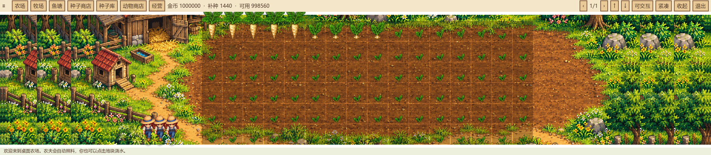
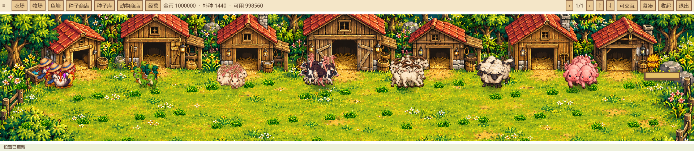
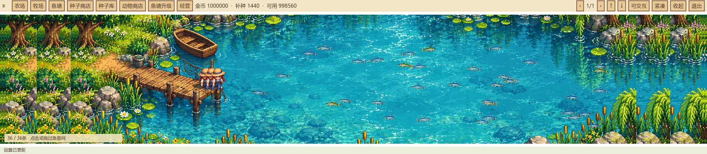
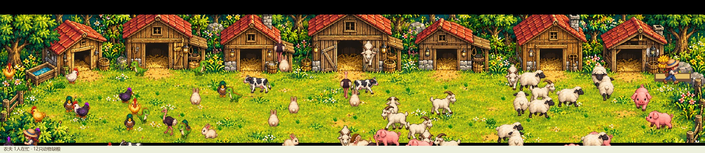

# 桌面农场0.8.1实际验收记录

日期：2026-10-03。基线0.8.0，完整范围按用户确认的[开发规划](development-plan-v0.8.1.md)执行。正式程序来自官方Godot4.7.2 Windows release模板，正常主场景入口，无外部脚本覆盖。实际运行截图如下。

## 正式程序画面

背景、作物、动物和农夫采用原创生成的高细节像素素材。三场景分别构图，经营实体不是烘焙在背景里的静态动物；底部大片文字/棚位卡片已取消。实际画面使用420总高，240紧凑模式保留世界尺度。当前树木、房屋和地面由场景背景统一缓存，活动演员按脚底排序；独立树冠/屋檐的进一步遮挡细化仍属后续美术迭代，不宣称与概念图逐像素一致。

## 自动回归

scripts/test.ps1 -Suite All最终完整通过；日志为.review/v081-all-complete.log。10个有计数的Godot套件共18,650条断言，另含原生API测试。原数值配置13项独立核验通过，production.json SHA256保持1945ea2ce932aa982406563ceeb12ff9ea4238396269106923bcbd9d025ef13d。

| 套件 | 通过数 | 覆盖 |
| --- | ---: | --- |
| Simulation | 440 | 经济、生产、持久化、满规模30有效分钟及恢复一致 |
| StageA | 222 | 独立地块、种子库、预算保护、任务领用 |
| SaveMigration | 147 | v1/v2→v3、不可覆盖备份、迁移失败保原档 |
| Controller | 110 | 商店与保存事务、首次/已收录鱼、失败回滚及旧待处理鱼 |
| PixelArt | 467 | 图标对应、缓存、输入、镜头及插值 |
| PondRules | 44 | 三鱼种自动结算、不重复登记、升级费用/冷却/容量 |
| RanchLife | 6,670 | 真实运动、绕障、整餐预约、远程进食拒绝、提前出发、互动、移动收取 |
| WorldLayout | 6,558 | 地块/草锚点、路线、障碍与旧坐标迁移 |
| DisplayModes | 273 | 展开/紧凑/收起、100/150/200%DPI与短工作区 |
| SceneAssets | 3,719 | 原素材来源、透明alpha、完整帧、四方向不同步态与缓存释放 |

真实图形测试另通过15条illustrated_view和18条raster_cache断言，检查实际像素、96地块、动物/鱼命中、观察不误触、镜头和隐藏不修改经济状态。新大动物图集均有独立4×4实际姿态；原小动物左向第五槽重复首帧的事实已记入素材清单，没有把复用帧计算为新增原始姿态。

## 正式EXE交互和动态演示

正式EXE自动交互验收退出0，stderr为空。实际检查启动无空白经营窗、三个窗口无永久置顶、420/240切换、鱼真实鼠标命中且不弹窗、动物互动、两条鱼升级、购种/选地/提交、全部经营面板、收起后菜单刷新和商店关闭。10个UI通过标记见.review/v081-release-ui.stdout.log；对应截图为.review/v081-release-ui*.png。

独立录制通过正式EXE正常入口，连续60.052秒，游戏实际推进60秒。321帧均不同，包含wandering、to_food、eating、idle。84只动物中82只首末位移超过48像素，最大583.39像素。记录模型真实坐标和整餐预约，动态画面不靠局部图标抖动模拟移动。录制夹具将首餐倒计时分散设为10～54秒，让1分钟内能观察觅食；未加速世界时间。记录与性能测试分开，录制开销不用于性能结论。

本地可播放记录：D:/game/.review/v081-motion/ranch-motion-60s.html；便携记录压缩包：D:/game/dist/DesktopFarm-v0.8.1-ranch-recording.zip。解压后用浏览器打开HTML，可暂停/拖动。原始坐标证据为.review/v081-motion/motion-samples.json。录像不纳入Git源码和主试玩包，避免大文件影响版本维护。

## 满规模持续运行与性能

模型运行96地块、96草点、84动物、9农夫、36鱼共1800有效秒，中点保存并恢复后再运行900秒，与连续运行完整快照完全相同，包括随机流、任务、预约和收益；末尾0只饥饿、250份产物收取、库存非负、资源上限守恒。它是模型30分钟验证，不是实际EXE30分钟墙钟运行。

正式EXE六模式各60秒的CPU、内存与渲染证据已完成，见[性能报告](release-performance-v0.8.1.md)。工作集峰值317.12～366.21MB，所有模式超过200MB目标；部分模式CPU超过2%目标。保留未达标结果，不以概念图或隐藏/清空工作集替代实测。

另做正式EXE牧场300秒连续运行，游戏推进300秒、保存成功，仍为96/96/84/9/36。测试期间Windows进入锁屏，结束时场景/工具栏按避让逻辑隐藏，严格采样器因开始/结束可见性不一致退出1。这段仅作为300秒计时/保存记录，不当作有效的持续可见性能样本。.review/v081-release-long-run/ranch_30/benchmark-runtime.json保存了全过程结果。

## 桌面窗口复测限制

原生HWND挂接、普通样式、同步休眠回调/恢复事件测试通过；负坐标显示器与100/150/200%DPI几何通过。正式EXE启动检查确认所有游戏窗口无topmost。

本轮后续的外部应用真实点击、七次全屏恢复、托盘快捷键、独立收起像素测试在锁屏环境未获得有效通过结果。诊断证明鼠标注入成功，但实际命中Windows LockApp（PID13780），受控目标点击数为0；被测游戏窗口均低于受控应用。锁屏也会抑制窗口显示/渲染及键盘菜单。不能把这些失败当作已通过或据此认定游戏主动抢前台。解锁后需重跑这四项真实桌面回归；未尝试解锁/绕过用户锁屏，也未关闭用户程序。

真实系统休眠、全部多显示器切换/拔插组合和商业发布签名尚未完成。独立测试存档与PID命名空间持续隔离；六模式性能验收确认正式玩家主档/.bak哈希保持不变。

## 使用与版本维护

先正常退出旧版，再解压DesktopFarm-v0.8.1-win64.zip启动DesktopFarm.exe。旧有效档迁移v3前保留不可覆盖版本备份；失败保留原档并停止启动。试玩包附规则、验收及性能说明。源码、原始生成素材、运行图集与文档共同由Git维护；工具、录像原始文件、测试缓存和便携二进制不入库。
