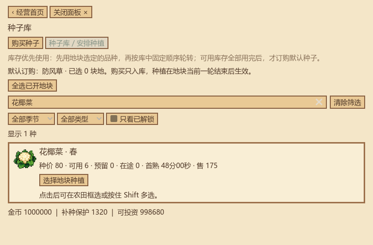
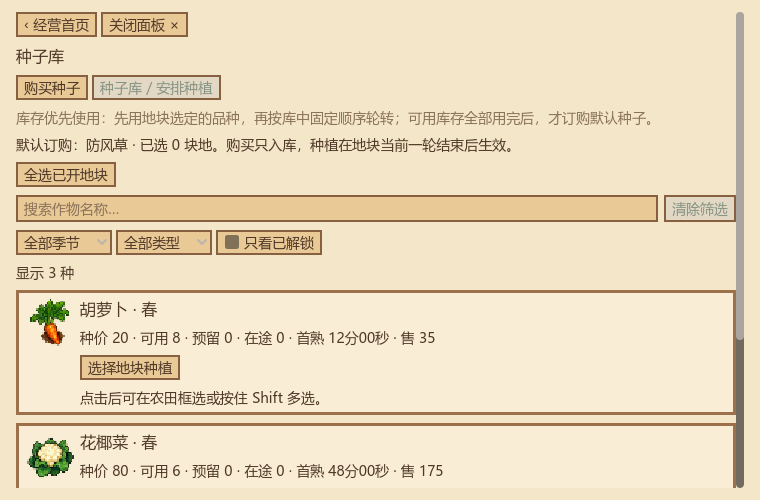
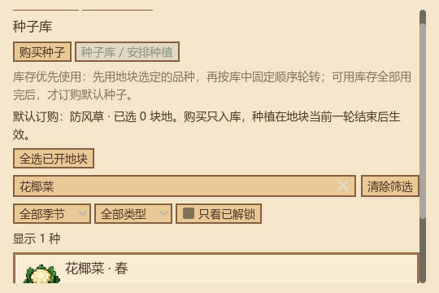

# 桌面农场 0.8.5 种子筛选修复验收

验收日期：2026-10-06。环境：Windows 11 x64、Intel Iris Xe、Godot 4.7.2。基于0.8.4，仅修改种子管理界面及刷新触发；继续使用SAVE6/Layout6。

## 原因及修复

原界面没有搜索框清空图标，也没有统一清除筛选入口；搜索、季节、类型和已解锁条件会保留到下次打开。长列表的滚动位置还可能让搜索区藏在上方。原来的文字删除回调能够更新列表，本次没有把键盘删除失效作为已证实的原因。

搜索框右侧新增×，只清关键词。「清除筛选」同时重置四个条件并回到顶部，重开经营页面也回到顶部。无匹配结果时提示清除筛选；真正没有库存时提示到商店购买。种子库恢复所有可用、预留或在途数量大于0的品种，种子商店恢复全部53种作物。

另修复库存新增、耗尽后的列表成员刷新。最后一粒种子被农夫领走后仍算在途，播种完成才从库中移除；将非专用播种任务的稳定标识纳入刷新判断，避免仅改变任务状态时漏更新。成员没变化时只刷新数量和报价，保留搜索框、光标、焦点和卡片；行走计时不触发这种刷新。

## 已执行检查

| 检查 | 实际结果 |
| --- | --- |
| 控制器回归 | 190项通过，含原有交易/面板、单结果/零结果/组合筛选清除、一次列表重建、原搜索控件保留、库存新增与耗尽。真实派工领走最后一枚种子、沿路径到达并完成动作后，在库存字典、预约、金币和保护预算均不变时，列表仍正确移除该品种。 |
| 原生鼠标输入 | 8次真实点击、89项检查通过。覆盖清除按钮、内置×、零结果、组合筛选、商店、540×360窄窗口和回顶。既有原生助手先检查窗口进程归属、鼠标命中窗口及前景状态，只操作本测试管理窗口与自己创建的外部窗口。 |
| 界面截图 | 已查看实际管理窗口截图：搜索/重置控件在窄窗口内可点击，过滤后与恢复后的数量正确。见下方截图。 |
| 导出成品 | Windows EXE正常结束，退出码0；文件/产品版本0.8.5.0。成品日志包含 `UI_SEED_FILTER_RESET_OK kinds=2`，验证从零结果恢复全部两种测试库存，模型状态不变；同时通过种植、商店、显示模式、收起恢复及批量捕鱼烟测。 |
| 打包核验 | 最终ZIP完成CRC检查，逐文件匹配manifest中的大小和SHA256；不包含源码测试、工具缓存或玩家存档。EXE/PCK/DLL的验收哈希见结构化记录。 |

结构化记录：[validation-v0.8.5.json](evidence/validation-v0.8.5.json)。原始日志：`.review/test-Controller.log`、`.review/v085-seed-filter-gui.log`、`.review/release-v085-smoke.log`；原生输入握手证据为结构化记录中的样本。源码回归在 `tests/test_controller.gd`，真实输入测试在 `tests/test_seed_filters.gd`。

## 验收范围

全部检查使用独立fixture，未读取或修改正式玩家存档，未停止用户正在玩的旧版程序。使用新版前请正常退出旧版，再解压启动 `DesktopFarm.exe`；可直接延续0.8.4的v6存档。

本轮未重跑0.8.4的完整17组回归，也未重测资源占用；生产规则、数值、布局、美术与原生DLL没有改动。完整玩法验收参考[0.8.4记录](validation-v0.8.4.md)，性能仍参考[0.8.4实测基线](release-performance-v0.8.4.md)，不将本次功能修复视为性能达标。
